# 🚀 The Journey: Modern Java & Spring Boot Engineering

Welcome to **The Journey** — an intensive, hands-on mentorship program designed to take you from initial fundamentals to a proficient, versatile **Modern Java Spring Boot Software Engineer**.

This repository is our shared workspace. It houses your roadmap, curated theory guides, practical coding exercises, milestone projects, and our collaborative progress & velocity tracking system.

---

## 🗺️ The Learning Roadmap

The curriculum follows a deliberate progression built upon the industry-standard [roadmap.sh](https://roadmap.sh) tracks, customized specifically for modern backend engineering with Java 21+ and Spring Boot 3+:

```mermaid
flowchart TD
    S0["Stage 0: Git & GitHub<br/><i>roadmap.sh/git-github</i>"] --> S1["Stage 1: Backend Fundamentals<br/><i>roadmap.sh/backend</i>"]
    S1 --> S2["Stage 2: Modern Java 21+<br/><i>roadmap.sh/java</i>"]
    S2 --> S3["Stage 3: Data Structures & Algorithms<br/><i>roadmap.sh/datastructures-and-algorithms</i>"]
    
    S3 --> M1["🌟 Milestone 1: CLI Analytics Engine<br/><i>Pure Java 21, DSA, File I/O, Testing</i>"]
    
    M1 --> S4["Stage 4: Vibe Coding & AI Tooling<br/><i>roadmap.sh/vibe-coding</i>"]
    S4 --> S5["Stage 5: LeetCode & Problem Solving<br/><i>roadmap.sh/leetcode</i>"]
    S5 --> S6["Stage 6: Relational Databases & SQL<br/><i>roadmap.sh/sql</i>"]
    
    S6 --> M2["🌟 Milestone 2: Spring Boot 3 REST API<br/><i>PostgreSQL, Flyway, Testcontainers, Swagger</i>"]
    
    M2 --> S7["Stage 7: Software Design & Clean Architecture<br/><i>roadmap.sh/software-design-architecture</i>"]
    
    S7 --> M3["🌟 Milestone 3: Hexagonal Core Engine<br/><i>DDD, Ports & Adapters, SOLID, ArchUnit</i>"]
    
    M3 --> S8["Stage 8: Software Architect & Distributed Systems<br/><i>roadmap.sh/software-architect</i>"]
    
    S8 --> M4["🌟 Milestone 4: Distributed Production Platform<br/><i>Kafka, Redis, Docker, Observability, Security</i>"]

    style M1 fill:#f9d71c,stroke:#333,stroke-width:2px,color:#000
    style M2 fill:#66bb6a,stroke:#333,stroke-width:2px,color:#000
    style M3 fill:#42a5f5,stroke:#333,stroke-width:2px,color:#fff
    style M4 fill:#ab47bc,stroke:#333,stroke-width:2px,color:#fff
```



### The 9 Curriculum Stages
1. **[Stage 00: Git & GitHub](curriculum/00-git-and-github/README.md)** — Branching, commits, pull requests, resolving merge conflicts, and collaboration.
2. **[Stage 01: Backend Fundamentals](curriculum/01-backend-fundamentals/README.md)** — How the web works: DNS, HTTP/HTTPS, REST, headers, status codes, API design.
3. **[Stage 02: Modern Java](curriculum/02-modern-java/README.md)** — Java 21 LTS, OOP, Records, Sealed classes, Collections, Streams, Concurrency, Virtual Threads, JUnit 5/AssertJ.
4. **[Stage 03: Data Structures & Algorithms](curriculum/03-data-structures-and-algorithms/README.md)** — Big-O notation, custom lists, maps, trees, graphs, sorting, searching.
5. **[Stage 04: Vibe Coding & AI Tooling](curriculum/04-vibe-coding-and-ai-tooling/README.md)** — AI-assisted engineering (Cursor, Copilot, Antigravity), spec prompting, test guardrails, hallucination detection.
6. **[Stage 05: LeetCode & Problem Solving](curriculum/05-leetcode-and-problem-solving/README.md)** — Curated algorithmic patterns (Two Pointers, Sliding Window, BFS/DFS, Trees, Dynamic Programming).
7. **[Stage 06: Relational Databases & SQL](curriculum/06-sql-and-relational-databases/README.md)** — PostgreSQL, relational modeling, complex joins, window functions, indexing, `EXPLAIN ANALYZE`, Flyway migrations.
8. **[Stage 07: Software Design & Clean Architecture](curriculum/07-software-design-and-architecture/README.md)** — SOLID principles, Gang of Four design patterns in Java, Hexagonal Architecture (Ports & Adapters), Domain-Driven Design (DDD).
9. **[Stage 08: Software Architect & Production Systems](curriculum/08-software-architect-and-production/README.md)** — Modular monolith vs microservices, Redis caching, Apache Kafka event streaming, Docker, Resilience4j, Prometheus/Grafana, Spring Security 6.

---

## 🏆 The 4 Milestone Projects

Between theory and exercises, you will build 4 comprehensive portfolio projects that synthesize everything learned:

| Milestone | Project Title | Key Technologies | Description |
|---|---|---|---|
| **M1** | [CLI Analytics & Expense Engine](milestones/milestone-1-cli-task-engine/README.md) | Pure Java 21, Collections, Streams, File I/O, JUnit 5 | Standalone transactional engine with data parsing, custom indexing, and statistical anomaly detection. |
| **M2** | [Modern Spring Boot 3 REST API](milestones/milestone-2-spring-boot-api/README.md) | Spring Boot 3, PostgreSQL, Flyway, Testcontainers, OpenAPI | Production-ready REST backend with relational data model, automated migrations, and containerized tests. |
| **M3** | [Hexagonal Core Domain Engine](milestones/milestone-3-clean-architecture/README.md) | Hexagonal Architecture, DDD, SOLID, ArchUnit | Pure business domain decoupled from frameworks, tested via ports & adapters with architectural boundary checks. |
| **M4** | [Distributed Production Platform](milestones/milestone-4-distributed-system/README.md) | Kafka, Redis, Docker Compose, Resilience4j, Prometheus/Grafana, Spring Security | Enterprise-grade distributed application with event streaming, caching, fault tolerance, and live monitoring. |

---

## 🤝 Mentorship & Workflow: How We Work Together

We use professional software engineering practices to simulate a real engineering team:

1. **Pick a Topic / Exercise**: Review the guide in [`curriculum/`](curriculum/) and check [`PROGRESS.md`](PROGRESS.md).
2. **Create a Feature Branch**:
   ```bash
   git checkout -b exercise/02-modern-java-streams
   ```
3. **Solve & Test**: Write your code and tests inside [`exercises/`](exercises/) or [`milestones/`](milestones/).
4. **Open a Pull Request**:
   * Use our [Pull Request Template](.github/PULL_REQUEST_TEMPLATE.md).
   * Fill out the self-reflection:
     * ⏱️ **Time Spent** (e.g. 2.5 hours)
     * 🎯 **Difficulty Rating** (1 = Breeze, 3 = Challenging, 5 = Tough)
     * 💡 **Key Takeaways & Blockers**
     * ❓ **Questions for Mentor**
5. **Code Review**: Mentor reviews the code asynchronously, leaving comments, suggestions, and tips.
6. **Approval & Merge**: Once approved, merge the PR, log your completion in [`PROGRESS.md`](PROGRESS.md), and celebrate!

---

## 📈 Velocity & Progress Tracking

We **do not** impose arbitrary deadlines. Everyone learns at their own pace. Instead, we monitor **velocity and momentum**:

* **[PROGRESS.md](PROGRESS.md)**: The master scorecard recording completion status, dates, hours logged, difficulty ratings, and PR links.
* **[Mentee Journal](logs/mentee-journal.md)**: Weekly or per-exercise log to capture insights, questions, and reflections.
* **CLI Tracker Tool**: Run `python3 tools/tracker.py` at any time to inspect:
  * Overall completion percentage
  * Total hours invested
  * Average cycle time per exercise
  * Topic difficulty distribution

---

## 🏁 Getting Started

Read the **[Mentee Onboarding Guide](MENTEE_ONBOARDING.md)** to configure your environment (JDK 21, IntelliJ IDEA / VS Code, Docker, Git) and submit your first PR!
